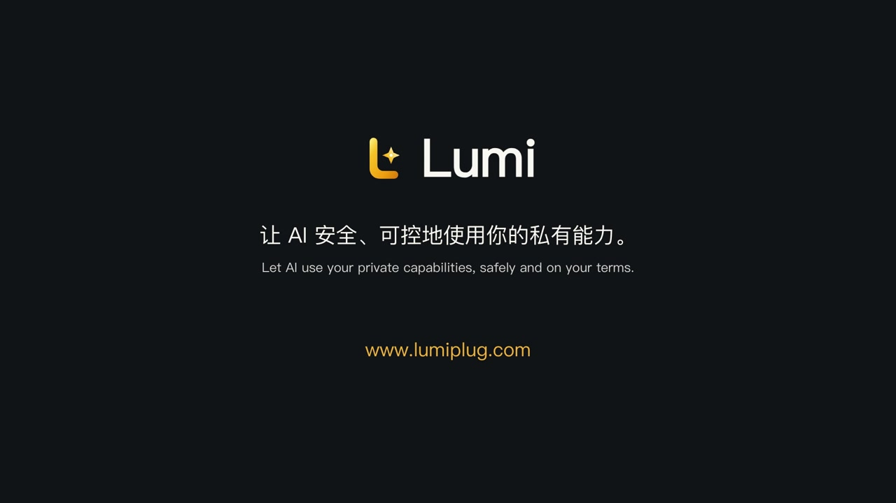

<!-- SPDX-License-Identifier: MPL-2.0 -->

# Lumi

**English** · [简体中文](README.zh-CN.md)

**Your tools and knowledge. Your control.**

Lumi is an open-source desktop app that brings your private tools, Skills, and project knowledge together on your own computer. Let AI call tools you have authorized, manage Skills visually, reuse knowledge across AI apps, and build a private workbench around the way you work.

**Status:** In active development. See the [product specification](docs/PRODUCT_SPEC.md) and [development plan](docs/DEVELOPMENT_PLAN.md) for scope and progress. Project documentation is currently primarily in Chinese.

## See Lumi in action

[](docs/assets/lumi-demo.mp4?raw=true)

[Watch or download the 84-second demo](docs/assets/lumi-demo.mp4?raw=true): a personal workbench, managed Skills, private tool calls, and shared project knowledge. English narration with Chinese and English captions. [Recording notes](docs/assets/README.md).

## What Lumi brings to your workflow

### Private tool calls, with control over what AI can see

**You decide what to expose.**

Turn scripts, private APIs, and MCP services into reusable tools. Review the complete configuration and authorize a tool before it becomes available. AI supplies public task parameters; Lumi adds the internal connection settings when executing the call. You control which fields are exposed through the tool interface.

Terminal, HTTP, and MCP tools share the same execution path for manual use and AI calls, with task status, logs, and results available for review.

### Visual Skills management

**See your Skills. Keep them organized.**

Browse Skills stored locally by different AI apps in one place. Read descriptions, explore file trees, and preview instructions and resources. Filter by source, search, and archive entries to keep your collection easy to navigate.

Import a discovered Skill from its details, or choose **Import directory** to install a local folder containing `SKILL.md` into Lumi. Lumi keeps an independent copy of its instructions and bundled files without changing the source. Connected AI apps can use `Lumi.search_skills`, `Lumi.get_skill`, and `Lumi.read_skill_file` to discover and read managed Skills on demand. Archiving a managed Skill stops MCP access until it is restored. Scripts are provided as content; execution and required dependencies remain with the AI client. Local directory installation is supported; repository downloads, ZIP packages, and automatic updates are not yet supported.

Local discovery covers standard directories for Codex, Claude Code, Qoder, QoderWork, Cursor, and Gemini CLI. Archiving hides an entry in Lumi without changing the original Skill files.

### Knowledge graphs across AI apps

**Connect your knowledge. Carry it into your next AI workflow.**

Organize project experience and knowledge into searchable documents and graphs, so the connections between ideas remain visible. Different AI apps can access the same knowledge through Lumi's unified Model Context Protocol (MCP) connection and continue from what you have already learned.

Knowledge is grouped by project and branch, with independent versions and readable history. Your AI app reads the project within its existing access scope and submits the organized knowledge to Lumi.

### Your private workbench

**Build a workspace around the way you work.**

Ask AI to build a workbench that brings your everyday entry points and project information together. Keep and adjust that workspace locally, with source export and version recovery.

Lumi provides an HTML/CSS/JavaScript template and browser SDK. AI can publish a workbench through MCP; workbench customization does not require you to install Node.js or run a build.

## Start with one tool

1. **Configure a tool.** Choose Terminal, HTTP, or MCP, then set its purpose, connection details, and parameters.
2. **Review and try it.** Check public parameters and internal fields, authorize the tool, and run it manually to inspect its logs and results.
3. **Connect your AI app.** Get the current MCP configuration from Lumi's settings and add it to your client. Use the same connection to call tools and work with project knowledge.
4. **Make the workbench yours.** Use a workbench prompt from Lumi to ask your AI app to build and publish your workspace.

For desktop test packages and platform requirements, see the [build and download guide](docs/DESKTOP_BUILDS.md).

## Current scope

Available today: Terminal/HTTP/MCP tool configuration and execution, local Skills browsing, managed installation and MCP discovery/reading, versioned project knowledge with search and graphs, and AI-authored workbenches with publishing, source export, and version recovery.

Automatic Skills synchronization between apps, Memory, persistent file/image artifacts, and richer result views remain in development or planning.

Tool authorization applies to the whole tool. Internal fields are excluded from the public tool interface; this does not imply encryption at rest or sandboxed tool execution. Review upstream responses for sensitive content. Network requests and data destinations depend on the tools and external AI clients you configure.

## Development

Built with Tauri 2, React, TypeScript, and a Node Core sidecar.

Install Node.js 26, pnpm 11.19.0, Rust, and the platform dependencies listed in the [Tauri prerequisites](https://v2.tauri.app/start/prerequisites/). See the [CI configuration](.github/workflows/ci.yml) for the current toolchain.

```sh
pnpm install
pnpm dev
```

Common commands:

```sh
pnpm check       # Type checks, lint, tests, and Rust checks
pnpm build       # Frontend and Core builds
pnpm tauri:build # Desktop app packaging
```

### Developing a workbench with AI

The official template uses `index.html`, `app.js`, and `style.css` as its root entry files. Add static assets or use a framework that produces compatible static output. The SDK exposes public Core tools, project storage, theme synchronization, and toast notifications. Authorized tools use the same registry as external AI clients and manual execution.

- [Workbench development plan](docs/HOMEPAGE_DEVELOPMENT_PLAN.md)
- [Template development guide](templates/html-home/LUMI_DEVELOPMENT.md)
- `pnpm sync:home` updates the version, SDK, and embedded template.
- `pnpm check:home-contract` checks their consistency.

<details>
<summary>Development-only one-shot UI action</summary>

Disabled by default. Enable the specified main-window tool action only during a normal `pnpm tauri dev` launch by passing `--lumi-dev-ui-action=terminal.start --lumi-dev-ui-target=<tool-UUID>`. For example:

```sh
pnpm tauri dev --no-watch --config <isolated-review-config.json> -- -- --lumi-dev-ui-action=terminal.start --lumi-dev-ui-target=<tool-UUID>
```

Open the corresponding run page directly in that main window; other windows receive no preset. The frontend module is gated by `import.meta.env.DEV`; the Rust module and audit command compile only with `debug_assertions`. A debug desktop package using the production frontend cannot trigger it, and release builds do not register it.

The sole registered action holds a reference to the real start button and calls its DOM `click()`, preserving validation, disabled state, duplicate-submission protection, and the Runner path. It does not call the execution API directly. The immutable startup preset is bound to the UUID; frontend concurrency protection and a single claim per Rust process prevent HMR or repeated Effect replay.

Auditing uses the host nonce and accepts only fixed events from the enabled main window with the matching UUID. It rejects unknown fields and actions, stores at most 64 events, and includes no user parameters, commands, or keys. The audit source is `development-ui`; the task still follows the existing manual UI path with `source=manual`. No control HTTP server, public listener, arbitrary selector, eval, shell capability, or new persistent credential is added.

After building the production frontend, run `node scripts/check-dev-ui-production.mjs [release-executable]` to verify that the development entry points are excluded.

</details>

## Documentation and contributing


- [Documentation index](docs/README.md)
- [Product specification](docs/PRODUCT_SPEC.md)
- [Technical architecture](docs/TECHNICAL_ARCHITECTURE.md)
- [MCP connection guide](docs/MCP_DESIGN.md)
- [Project and branch knowledge](docs/KNOWLEDGE_BRANCHES.md)
- [Desktop builds and downloads](docs/DESKTOP_BUILDS.md)
- [Contributing guide](CONTRIBUTING.md)

## License

Lumi is licensed under the **Mozilla Public License 2.0 (MPL-2.0)**. See [LICENSE](LICENSE) for the full terms and the [licensing and branding notes](docs/LICENSING.md) for scope and brand usage.

MPL-2.0 permits commercial use, modification, and distribution. When distributing covered files or their modifications, provide the corresponding source as required by the license. Independent new files containing no MPL-covered code may use another license. Third-party dependencies retain their own licenses.

The license does not grant rights to Lumi trademarks or logos.
